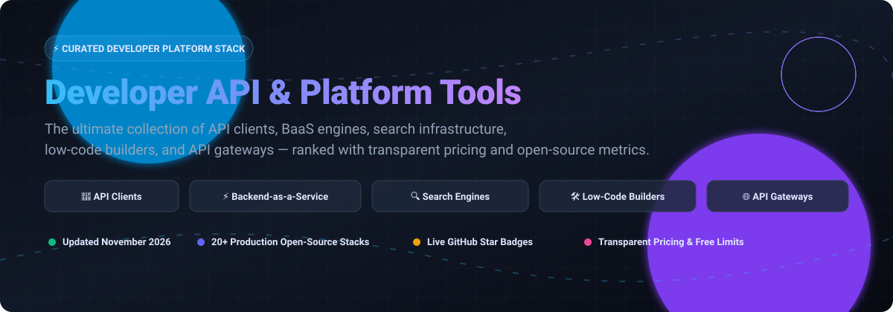

  

# 🚀 Awesome Developer API & Platform Tools

  
  
  
  
  
  

---

## 📖 Executive Summary & Overview

Welcome to **Awesome Developer API & Platform Tools** 🌟 — a comprehensive, search-optimized catalog of industry-leading **SaaS developer platforms** and high-velocity **open-source developer tooling infrastructure**. 

Whether you are architecting a cloud-native microservices mesh, designing high-throughput REST or GraphQL endpoints, provisioning self-hosted BaaS databases, or creating low-code internal operational panels, this repository benchmarks each product with **precise tier pricing**, **explicit free-tier limits**, and **real-time GitHub popularity metrics**.

### 🎯 Key Target Domains
- **API Clients & Testing Environments**: Declarative, Git-native, and multi-protocol API suites.
- **Backend-as-a-Service (BaaS) & Headless CMS**: Production PostgreSQL/SQLite datastores with built-in auth, realtime sync, and file storage.
- **Search & Discovery Infrastructure**: Ultra-fast, typo-tolerant full-text and hybrid vector search engines.
- **Low-Code & Rapid Application Builders**: Drag-and-drop dashboards and internal tools with granular RBAC.
- **API Gateways & Ingress Controllers**: Cloud-native reverse proxies, dynamic routing, and traffic management engines.

---

## 📑 Table of Contents

- [📊 Sector Overview & Market Dynamics](#-sector-overview--market-dynamics)
- [☁️ SaaS & Hosted Platforms](#️-saashosted-platforms)
- [🐙 Open-Source GitHub Projects (Ranked by Stars)](#-open-source-github-projects-ranked-by-stars)
  - [⚡ Backend-as-a-Service & CMS](#-backend-as-a-service--headless-cms)
  - [🚀 API Clients & Protocol Testers](#-api-clients--protocol-testers)
  - [🌐 API Gateways & Traffic Ingress](#-api-gateways--traffic-ingress)
  - [🛠️ Low-Code & Internal Tool Platforms](#️-low-code--internal-tool-platforms)
  - [🔍 Search & Discovery Infrastructure](#-search--discovery-infrastructure)
  - [🧰 Command-Line & Developer Utilities](#-command-line--developer-utilities)
- [🤝 How to Contribute](#-how-to-contribute)
- [⚖️ Architecture Decision Guide & Disclaimer](#️-architecture-decision-guide--disclaimer)
- [⭐ Star History](#-star-history)
- [💖 Support & Sponsorship](#-support--sponsorship)

---

## 📊 Sector Overview & Market Dynamics

The global Developer API Platform & API Management market is estimated at **$7.6B to $10.3B** and projected to exceed **$30B+ by 2032–2034**, expanding at a compound annual growth rate (CAGR) of **16%–22%**. 

The sector displays a distinctive **bifurcated market structure**:
1. **Infrastructure Consolidation (Top Layer)**: The foundational cloud backbone is moderately concentrated among hyperscalers (Microsoft Azure/GitHub, Alphabet/Google Cloud Firebase, and Amazon Web Services Amplify), which command extensive aggregate enterprise market share.
2. **Vertical Specialization & Open-Source Disruption (Ecosystem Layer)**: Downstream domains—such as developer-first API clients, low-code operational panels, typo-tolerant search APIs, and BaaS frameworks—remain **intensely fragmented**. Modern engineering organizations increasingly adopt best-of-breed open-source platforms to secure strict data sovereignty, prevent hyperscaler lock-in, and bypass steep metered billing tiers.

---

## ☁️ SaaS/Hosted Platforms

The table below catalogs premier SaaS developer platforms, arranged in **descending order of company scale** (valuation / market capitalization / ARR), featuring exact tier pricing and verifiable free limits:

| Product | Company Size (Valuation / Revenue) | Category / Focus | Starting Pricing | Free Tier / Free Trial Limits | Best For / Key Trade-off |
| :--- | :--- | :--- | :--- | :--- | :--- |
| **GitHub** | **~$3.88T Market Cap** (Parent: Microsoft) / **~$2B ARR** | Code Hosting & DevOps | **$4 / user / month** (Team plan) | **Free forever plan**: Unlimited public/private repositories, **2,000 CI/CD Actions minutes/month** (private repos), **500 MB** package storage. | **Best for:** Integrated source control & CI/CD. **Trade-off:** Advanced governance locked behind Enterprise ($21/user/mo). |
| **Firebase** | **~$3.42T Market Cap** (Parent: Alphabet/Google) | Backend-as-a-Service | **Pay-as-you-go** ($0 base fee on Blaze plan; Firestore reads ~$0.03 / 100k) | **Free forever plan (Spark)**: **50,000 document reads/day**, **20,000 document writes/day**, **1 GB** stored data, **50,000 Auth MAUs**, **10 GB hosting storage**, 360 MB hosting transfer/day. | **Best for:** Rapid mobile & web app development. **Trade-off:** NoSQL focus; proprietary API lock-in. |
| **AWS Amplify** | **~$2.60T Market Cap** (Parent: Amazon/AWS) | Full-Stack App Platform | **Pay-as-you-go** ($0.01 / build minute, $0.023 / GB storage, $0.15 / GB data served) | **Free forever plan**: **1,000 build minutes/month**, **5 GB hosting storage/month**, **15 GB data served/month**, 100 GB-hours/month SSR duration. | **Best for:** AWS-centric frontend & backend workflows. **Trade-off:** Steep learning curve when configuring underlying AWS IAM & services. |
| **Stripe** | **$159B Valuation** / **~$6.8B Revenue** | Payment Infrastructure | **2.9% + $0.30** per successful card transaction | **Free forever developer sandbox**: **Free test mode (no time limit)** with full API simulation; live processing has **$0 / month base subscription** (pay only per successful transaction, min $0.50 charge). | **Best for:** Mature, production-grade payment workflows. **Trade-off:** High transaction margins on international & converted currencies. |
| **Twilio** | **~$35B Market Cap** / **~$5.07B Revenue** | Communication APIs | **$0.0083 / SMS message** segment (US) + $1.15/month phone number rental | **30-day Free Trial**: **100 SMS messages**, **100 WhatsApp messages**, **75 voice minutes**, **3,000 SendGrid emails**, and up to 3 trial phone numbers (restricted to verified numbers). | **Best for:** Global multi-channel telecom & messaging. **Trade-off:** Carrier pass-through surcharges and A2P compliance overhead scale costs quickly. |
| **HubSpot Developer Platform** | **~$30B Market Cap** / **~$3.13B Revenue** | CRM & App Marketplace | **$20 / seat / month** (Starter Customer Platform; $15/seat/mo billed annually) | **Free forever developer account**: **Up to 10 developer test accounts** (with 90-day renewable access to Enterprise CRM features, 25 website pages, 100,000 workflow enrollments/day, and 250,000 API requests/day ceiling). | **Best for:** B2B integration builders and SaaS ecosystems. **Trade-off:** Steep tier jumps into Professional & Enterprise pricing. |
| **Supabase** | **$10.5B Valuation** / **~$170M ARR** | Backend-as-a-Service | **$25 / organization / month** (Pro plan base, includes $10 compute credit) | **Free forever plan**: **2 active projects** (pauses after 7 days inactivity), **500 MB database space**, **1 GB file storage**, **50,000 MAUs**, **500,000 edge function invocations**, **2M realtime messages**, 5 GB data egress. | **Best for:** Postgres-native backend with auth & storage. **Trade-off:** Strict database storage ceilings on free tier; compute add-ons require Pro plan. |
| **Postman** | **$5.6B Valuation** / **~$313M ARR** | API Client & Platform | **$19 / user / month** (Team plan billed annually; $14/user/mo Basic) | **Free forever plan**: **1 user** solo workspace, **10,000 Postman API calls/month**, **5 integrations**, unlimited manual collection runs & mock server requests. | **Best for:** Collaborative API design, testing & docs. **Trade-off:** Free plan strictly limits team sharing; requires paid upgrade for multi-seat collaboration. |
| **Retool** | **$3.2B Valuation** / **~$130M ARR** | Internal Tool Builder | **$10 / builder / month** + $5 / internal user / month (Team plan billed annually) | **Free forever plan**: **Up to 5 total users** (builders + internal users), **unlimited apps**, **500 workflow runs/month**, **5 GB Retool Database storage**, 20 hours/month Retool Agents. | **Best for:** Rapid internal dashboards and operational tools. **Trade-off:** Pricing scales per-builder and per-end-user; staging environments locked to paid plans. |
| **Algolia** | **$2.3B Valuation** / **~$100M ARR** | Search & Discovery API | **Pay-as-you-go** ($0 base monthly fee on Grow plan; overages at $0.50 / 1k searches, $0.40 / 1k records) | **Free forever plan (Grow)**: **10,000 search requests/month** and **100,000 records** stored across indices. | **Best for:** Instant typo-tolerant search-as-you-type. **Trade-off:** Costs scale sharply with search query traffic spikes. |

---

## 🐙 Open-Source GitHub Projects (Ranked by Stars)

Below is an expanded roster of production-grade open-source developer platforms and API tooling suites. Every entry features a **live social star badge** linked directly to its repository stargazers page, ordered strictly by popularity and community adoption.

---

### ⚡ Backend-as-a-Service & Headless CMS

1. **Supabase** 
   - **Focus**: PostgreSQL-native BaaS with Row-Level Security (RLS), auto-generated REST/GraphQL APIs, Auth, Storage, and Realtime listeners (Apache-2.0 core).
   - **Key Capabilities**: Full SQL flexibility, edge functions, Postgres extension compatibility, and native Docker Compose deployment.
   - **Trade-off**: Requires dedicated PostgreSQL DBA monitoring when scaled to billions of rows compared to managed NoSQL.
   - **Best For**: Applications seeking enterprise SQL relational power without vendor lock-in.

2. **Strapi** 
   - **Focus**: The leading open-source headless CMS and API engine built on Node.js and TypeScript (MIT).
   - **Key Capabilities**: Instant REST and GraphQL endpoints from custom content schemas, customizable admin panel, multi-database support (PostgreSQL, SQLite, MySQL).
   - **Trade-off**: Heavy RAM consumption under burst traffic; enterprise RBAC features are commercially licensed.
   - **Best For**: Content-heavy applications, multi-channel editorial platforms, and API-first web apps.

3. **PocketBase** 
   - **Focus**: Single-file, zero-dependency embedded BaaS written in Go with SQLite (MIT).
   - **Key Capabilities**: Embedded SQLite with WAL mode, real-time subscriptions, client SDKs (JS/Dart/Python), authentication with OAuth2, and built-in file admin dashboard.
   - **Trade-off**: Single-node SQLite architecture limits high concurrent write throughput.
   - **Best For**: Prototyping, indie hackers, micro-SaaS, and self-contained mobile app backends.

4. **Appwrite** 
   - **Focus**: Containerized multi-service BaaS with cross-platform SDKs for web, mobile, and flutter (BSD-3).
   - **Key Capabilities**: Built-in authentication, MariaDB storage abstractions, webhooks, asynchronous background tasks, and scheduled serverless functions.
   - **Trade-off**: Multi-container Docker overhead; lacks native PostgreSQL Row-Level Security.
   - **Best For**: Mobile and full-stack developers prioritizing straightforward Docker Compose deployments.

5. **Directus** 
   - **Focus**: Real-time Data Platform and headless API wrapper for any SQL database (GPL-3.0 / BSL).
   - **Key Capabilities**: Instant RESTful and GraphQL endpoints on top of existing PostgreSQL, MySQL, SQLite, or Oracle databases with zero data lock-in.
   - **Trade-off**: Complex permission inheritance for intricate multi-tenant role structures.
   - **Best For**: Layering modern APIs and intuitive management dashboards over legacy SQL databases.

6. **SurrealDB** 
   - **Focus**: Next-generation multi-model database (Document, Graph, Key-Value) with integrated WebSocket APIs (BSL 1.1).
   - **Key Capabilities**: SurrealQL query language, built-in client authentication, real-time live queries, and graph traversal algorithms.
   - **Trade-off**: Newer ecosystem with specialized query syntax.
   - **Best For**: Real-time applications demanding connected graph structures with collaborative syncing.

---

### 🚀 API Clients & Protocol Testers

1. **Hoppscotch** 
   - **Focus**: Ultra-fast, lightweight web & desktop API development ecosystem (MIT).
   - **Key Capabilities**: Multi-protocol execution covering REST, GraphQL, WebSocket, Server-Sent Events (SSE), Socket.IO, and MQTT; progressive web app (PWA) with offline caching.
   - **Trade-off**: Cloud workspace team sync features require commercial hosted tier or enterprise container configurations.
   - **Best For**: Teams demanding rapid, zero-install browser testing across modern real-time protocols.

2. **Bruno** 
   - **Focus**: Offline-first, Git-native desktop API client (MIT).
   - **Key Capabilities**: Stores API requests as plain-text `.bru` files directly inside code repositories, enabling peer-reviewed pull requests; native scripting, environments, and CLI runner.
   - **Trade-off**: `.bru` files require conversion tooling for direct OpenAPI specification sync.
   - **Best For**: Engineering teams prioritizing absolute data sovereignty, security, and GitOps collaboration over cloud sync.

3. **Scalar** 
   - **Focus**: Modern, interactive OpenAPI reference generator and REST API testing client (MIT).
   - **Key Capabilities**: Instant API documentation rendering from OpenAPI/Swagger JSON/YAML specs, integrated interactive test playground, client code snippet generator.
   - **Trade-off**: Primarily tailored for RESTful OpenAPI specifications.
   - **Best For**: Developers who want high-performance, beautiful API documentation with interactive testing built-in.

---

### 🌐 API Gateways & Traffic Ingress

1. **Traefik** 
   - **Focus**: Cloud-native edge router and dynamic reverse proxy written in Go (MIT).
   - **Key Capabilities**: Automatic service discovery from Docker, Kubernetes, Consul, and Nomad; zero-reload dynamic configuration, automatic Let's Encrypt TLS certificates.
   - **Trade-off**: Focused primarily on traffic routing and L4/L7 ingress rather than complex API transformation workflows.
   - **Best For**: Containerized microservices requiring continuous, automated route discovery and zero-downtime reconfiguration.

2. **Kong Gateway OSS** 
   - **Focus**: High-throughput cloud-native API gateway built on NGINX and LuaJIT (Apache-2.0).
   - **Key Capabilities**: DecK CLI for declarative configuration management (GitOps for gateways), vast plugin ecosystem covering JWT auth, rate limiting, and caching; DB-less or PostgreSQL modes.
   - **Trade-off**: Enterprise governance and analytics features are reserved for proprietary Enterprise licenses.
   - **Best For**: High-load enterprise platforms requiring proven, battle-tested gateway performance.

3. **Apache APISIX** 
   - **Focus**: Dynamic, real-time, high-performance API gateway under Apache Software Foundation governance (Apache-2.0).
   - **Key Capabilities**: etcd-backed dynamic configuration hot-reloading without server restarts, multi-language plugin runners (Java, Python, Go, Wasm), Kubernetes ingress controller.
   - **Trade-off**: Requires dedicated etcd cluster infrastructure for production distributed deployments.
   - **Best For**: Teams seeking vendor-neutral, highly customizable multi-language gateway routing.

4. **KrakenD** 
   - **Focus**: Ultra-high-performance stateless API gateway written in Go (Apache-2.0).
   - **Key Capabilities**: Pure stateless architecture (no database, no coordination required), declarative JSON/YAML configuration, response manipulation and aggregation.
   - **Trade-off**: Lacks built-in UI dashboard or dynamic etcd-style route push mechanisms.
   - **Best For**: Extreme throughput scenarios where raw latency and linear horizontal scalability are paramount.

---

### 🛠️ Low-Code & Internal Tool Platforms

1. **NocoDB** 
   - **Focus**: Open-source smart spreadsheet that turns any relational database into an Airtable-like platform (AGPL-3.0).
   - **Key Capabilities**: Instant spreadsheet interface over PostgreSQL, MySQL, SQL Server, and SQLite; REST APIs, grid, gallery, kanban, and form views.
   - **Trade-off**: Tailored around tabular records rather than multi-page complex dashboard workflows.
   - **Best For**: Business teams and operations creating database spreadsheets and visual data collection portals.

2. **ToolJet** 
   - **Focus**: Low-code framework for building secure internal operational tools (AGPL-3.0).
   - **Key Capabilities**: Visual drag-and-drop builder with 50+ pre-built widgets, 40+ native data connectors, AI-assisted app generation, and collaborative multiplayer canvas.
   - **Trade-off**: Advanced multi-tier organizational permissions require Enterprise licensing.
   - **Best For**: Fast-growing engineering teams seeking rapid UI creation backed by automated queries.

3. **Appsmith** 
   - **Focus**: Mature open-source platform to build admin panels, operational dashboards, and database tools (Apache-2.0).
   - **Key Capabilities**: JavaScript/TypeScript anywhere inside widgets, 25+ database connectors, Git version control integration, self-hosted Docker deployment.
   - **Trade-off**: Complex widget interactions can demand notable JavaScript authoring.
   - **Best For**: Engineering teams building complex internal web portals that demand custom programmatic business logic.

4. **Refine** 
   - **Focus**: Code-first React framework for building internal tools, admin panels, and B2B dashboards (MIT).
   - **Key Capabilities**: Connects directly with REST and GraphQL backends, headless architecture works with any UI framework (Ant Design, Material UI, Mantine, Tailwind CSS).
   - **Trade-off**: Requires frontend developer coding expertise—not a drag-and-drop tool for non-technical users.
   - **Best For**: Developers seeking full TypeScript control and composability without low-code visual limitations.

5. **Budibase** 
   - **Focus**: Low-code tool builder with automated database scaffolding and built-in automation (GPL-3.0).
   - **Key Capabilities**: Generous self-hosting allowance (free up to 20 users), auto-generated CRUD interfaces, internal SQLite database, multi-step workflow automations.
   - **Trade-off**: Less flexible custom CSS styling compared to pure code-first frameworks.
   - **Best For**: IT departments and small teams seeking immediate turn-key utility without developer overhead.

---

### 🔍 Search & Discovery Infrastructure

1. **Meilisearch** 
   - **Focus**: Lightning-fast, typo-tolerant search engine written in Rust (MIT Community Edition).
   - **Key Capabilities**: Sub-50ms response times, intuitive out-of-the-box relevance ranking, instant search-as-you-type, built-in faceting and filtering.
   - **Trade-off**: Single-node Community Edition; multi-node high-availability sharding is commercially licensed.
   - **Best For**: E-commerce catalogs, application search, and SaaS documentation search requiring minimal tuning.

2. **Typesense** 
   - **Focus**: Fast, typo-tolerant search engine written in C++ optimized for developer delight (GPL-3.0).
   - **Key Capabilities**: In-memory data store with disk persistence, Raft-based clustering for high-availability, vector and hybrid search capabilities, dramatic cost savings vs. hosted SaaS search.
   - **Trade-off**: Requires in-memory RAM capacity proportional to index size and record volume.
   - **Best For**: High-volume, real-time search queries where predictable latency and cost efficiency are crucial.

3. **Infinity** 
   - **Focus**: AI-native database tailored for high-speed dense vector, sparse vector, and full-text search (Apache-2.0).
   - **Key Capabilities**: Hybrid vector and keyword retrieval, multi-vector query support, optimized for Retrieval-Augmented Generation (RAG) pipelines.
   - **Trade-off**: Emerging project targeting AI/RAG workloads rather than classical web shop faceting.
   - **Best For**: Next-generation generative AI agent memory and enterprise LLM knowledge bases.

---

### 🧰 Command-Line & Developer Utilities

1. **HTTPie** 
   - **Focus**: Human-friendly command-line HTTP client written in Python (BSD-3).
   - **Key Capabilities**: Colorized terminal output, formatted JSON responses, intuitive syntax, persistent sessions, and file download resumes.
   - **Trade-off**: Not designed for continuous automated regression assertion test suites.
   - **Best For**: Rapid terminal exploration, CLI debugging, and API smoke tests.

2. **Hurl** 
   - **Focus**: Command-line tool that executes HTTP requests defined in simple plain text (Apache-2.0).
   - **Key Capabilities**: Formats tests in clear, human-readable text files; evaluates JSONPath, XPath, and regex assertions; integrates natively into CI/CD pipelines.
   - **Trade-off**: Command-line focused with no standalone graphical desktop UI.
   - **Best For**: Engineers treating API integration test scenarios strictly as versioned code in Git repositories.

---

## 🤝 How to Contribute

Contributions are wholeheartedly welcomed! Help us keep this developer platform resource up-to-date and comprehensive:

1. **Fork the Repository**: Click the **Fork** button at the top right of this page.
2. **Clone & Branch**: `git checkout -b feature/add-new-tool`
3. **Format Standard**:
   - Provide the project name, official URL, and GitHub repository link.
   - Include the active open-source license and official tech stack.
   - Detail the primary capabilities, explicit trade-offs, and target ideal use case.
   - For SaaS additions, provide exact starting tier prices and verified free tier allowances.
4. **Submit a Pull Request**: Provide a concise description of why the tool is valuable to developer platform engineers.

---

## ⚖️ Architecture Decision Guide & Disclaimer

- **Categorical Clarity**: Understanding layer boundaries is essential for sound architecture. API clients (**Bruno**, **Hoppscotch**) compose and execute requests; BaaS engines (**Supabase**, **PocketBase**) manage databases and state; search engines (**Typesense**, **Meilisearch**) index unstructured data; low-code platforms (**Appsmith**, **ToolJet**) deliver operational UIs; and API gateways (**Kong**, **Traefik**, **APISIX**) route network traffic.
- **Data Sovereignty vs. Operational Overhead**: Self-hosted solutions eliminate SaaS seat fees and ensure absolute control over proprietary enterprise data. However, they require proactive database backups, container patching, and network perimeter protection.
- **Independent Community Compilation**: All trademarks and logos belong to their respective copyright holders. Product listings and comparative reviews are factual and intended for architectural evaluation.

---

## ⭐ Star History

---

## 💖 Support & Sponsorship

Thank you for exploring and utilizing **Awesome Developer API & Platform Tools**! ❤️

Building and maintaining high-quality, up-to-date open-source developer resources takes substantial time, research, and passion. If this catalog helped you choose the right architecture, saved your team money, or introduced you to new tooling, please consider supporting the project:

- ⭐ **Star the Repository**: Show your support and help other developers discover this collection.
- 🍴 **Fork & Share**: Share it with your developer community, platform team, or social networks.
- ☕ **Sponsor & Buy a Coffee**: Support ongoing maintenance directly via the [GitHub Sponsor Dashboard](https://github.com/sponsors/ishandutta2007).

Your generous encouragement fuels continuous updates, in-depth benchmarks, and open developer advocacy! 🚀
